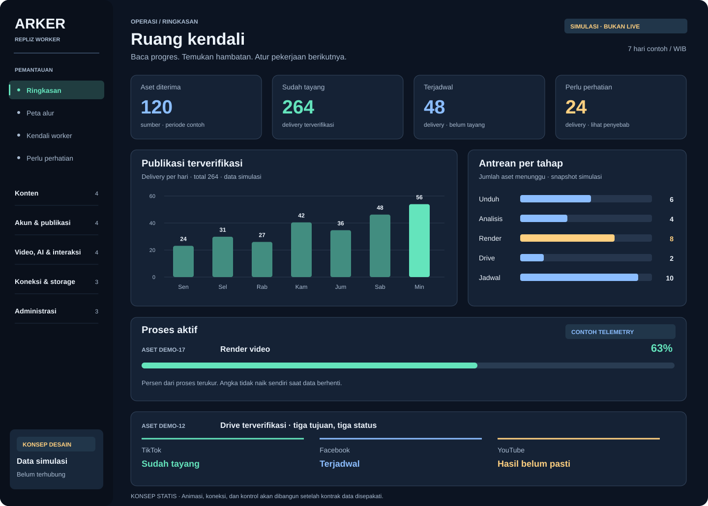

# Arker · Repliz Worker

**Panel kendali untuk memahami alur konten dan mengatur worker dari satu tempat.**

Target: web app dengan chart, progress beranimasi, konfigurasi Repliz, bank konten, dan Google Drive. Dirancang untuk Windows, macOS, dan Linux.

> **Status: perencanaan dan fondasi dokumentasi.** Repo ini belum menjalankan worker, login, koneksi Repliz, atau publikasi. Gambar menggunakan data simulasi. CI memeriksa dokumen dan spesifikasi, bukan membuktikan aplikasi produksi sudah berjalan.



[Rencana produk](docs/plans/PRODUCT_PLAN.md) · [Menu lengkap](docs/plans/NAVIGATION.md) · [Visual dan animasi](docs/plans/UX_PLAN.md) · [Konfigurasi](docs/plans/CONFIGURATION_PLAN.md) · [Roadmap](docs/plans/ROADMAP.md)

## Apa yang akan bisa dilakukan?

- Memantau perjalanan satu link menjadi satu aset dengan tiga tujuan: TikTok, Facebook Page, dan YouTube Shorts.
- Melihat bagian yang lambat melalui chart durasi tahap, umur antrean, dan hasil per platform.
- Mengatur akun, jadwal, persona, hook, balasan komentar, dan laporan dari formulir yang mudah dibaca.
- Mengelola kredensial Repliz melalui input rahasia di backend, serta memilih bank konten dan folder Google Drive.
- Membedakan konfigurasi **tersimpan**, **menunggu diterapkan**, dan **aktif di worker**.
- Memeriksa hasil pengiriman yang belum pasti sebelum mencoba tindakan berikutnya.

## Arsitektur yang direncanakan


Browser mengirim perintah ke layanan kontrol. Worker mengambil perintah yang sudah divalidasi, menjalankan pekerjaan, lalu mengirim status kembali. Kredensial hanya tersedia bagi layanan yang membutuhkannya; browser tidak memanggil Repliz langsung.

Proyek ini terpisah dari instalasi worker yang sudah ada. Tidak ada kode privat, database, token, bank konten, atau runtime produksi yang disalin. Instalasi baru tetap dalam mode simulasi sampai akun, penyimpanan, dan pemilik pengiriman ditetapkan. Dua instalasi tidak boleh mengirim untuk akun/post yang sama secara bersamaan.

## Navigasi produk

| Bagian | Menu |
| --- | --- |
| Pemantauan | Ringkasan; Peta alur; Kendali worker; Perlu perhatian |
| Konten | Tambah konten; Batch & antrean; Bank konten; Detail & preview |
| Akun & publikasi | Akun sosial; Rotasi & kuota; Kalender posting; Hasil publikasi |
| Video, AI & interaksi | Pengolahan video & AI; Persona & caption; Komentar & balasan; Laporan & statistik |
| Koneksi & penyimpanan | Koneksi layanan; Telegram & notifikasi; Penyimpanan & cleanup |
| Administrasi | Backup & pemulihan; Riwayat aktivitas; Pengaturan & akses |

Ke-22 menu adalah cakupan rancangan. Halaman yang belum diimplementasikan tidak ditampilkan sebagai tombol aktif dalam rilis produk.

## Chart dan progress yang bermakna

| Tampilan | Pertanyaan yang dijawab |
| --- | --- |
| Tren konten masuk dan publikasi terverifikasi | Apakah pekerjaan selesai mengikuti jumlah pekerjaan masuk? |
| Antrean per tahap | Pekerjaan menumpuk di bagian mana? |
| Durasi tahap dan waktu menunggu | Apakah download, AI, render, Drive, atau provider yang lambat? |
| Kuota terpakai, dipesan, dan tersisa | Akun mana yang masih bisa menerima jadwal? |
| Timeline satu video dan tiga jalur tujuan | Bagian mana sudah selesai dan mana yang masih tertahan? |

Persentase hanya muncul ketika jumlah pekerjaan atau ukuran total diketahui. Tahap tanpa ukuran pasti menampilkan nama tahap dan waktu berjalan. “Terjadwal” tidak dihitung sebagai “Sudah tayang”. Animasi mengikuti data, berhenti ketika data usang, dan menghormati pengaturan gerak minimal.

## Pengaturan koneksi


- **Repliz:** Access Key dan Secret Key, tes koneksi hanya-baca, identitas koneksi, waktu tes, serta status aktivasi. Nilai yang sudah tersimpan tidak dikirim kembali ke browser.
- **Bank konten:** pilih folder pada mesin worker, periksa volume, hak akses, ruang kosong, dan keterkaitannya dengan folder Drive. Pemilihan dari HP tetap memilih folder mesin worker, bukan folder HP.
- **Google Drive:** masukkan link folder, baca ID, verifikasi akses serta kecocokan file. Sinkronisasi dan pemeriksaan checksum merupakan dua hal berbeda.

Perubahan lokasi hanya berlaku untuk pekerjaan baru setelah pemeriksaan. Aset lama mempertahankan referensinya. Pemindahan arsip menjadi pekerjaan migrasi tersendiri.

## Windows, macOS, dan Linux

| Komponen | Target dukungan | Status saat ini |
| --- | --- | --- |
| Dokumentasi dan validator | Windows / macOS / Linux, Python 3.12+ | Tersedia; matriks CI memeriksa fondasi ini |
| Web UI dan layanan kontrol | Ketiga OS | Direncanakan |
| Worker, FFmpeg, dan downloader | Ketiga OS melalui adapter | Belum diimplementasikan atau diuji lintas OS |
| Sinkronisasi Drive Desktop | Windows / macOS | Integrasi direncanakan |
| Sinkronisasi Drive Linux | Adapter sinkronisasi terpisah | Belum dipilih dan belum diuji |
| Paket aplikasi desktop | Ketiga OS, setelah web stabil | Tahap lanjutan |

Google menyatakan Drive for desktop tidak tersedia di Linux. Dukungan Linux memerlukan adapter sinkronisasi yang diuji, bukan mengganti nama perintah macOS. Lihat [persyaratan Google Drive](https://support.google.com/drive/answer/2375082?hl=en) dan [rencana lintas platform](docs/architecture/CROSS_PLATFORM.md).

## Struktur proyek

```text
apps/                       Batas tanggung jawab web, API, dan worker yang direncanakan
config/examples/            Contoh konfigurasi tanpa rahasia
docs/
  architecture/             Komponen, kontrak kontrol, dan dukungan OS
  assets/                   Diagram SVG dan konsep dashboard
  plans/                    Produk, menu, UX, konfigurasi, roadmap
  WORKLOG.md                Jejak pekerjaan dan batas bukti
spec/                       Spesifikasi menu dan metrik yang dapat dibaca mesin
scripts/                    Validator dan pembuat visual dokumentasi
tests/                      Pemeriksaan validator publikasi repo
.github/                    CI lintas OS dan template kontribusi
```

## Memeriksa repo

Jalankan dari folder repo dengan Python 3.12 atau lebih baru:

```sh
python scripts/validate.py
python -m unittest discover -s tests -v
```

Pada sistem yang menyediakan Python sebagai `python3`, gunakan nama tersebut. Perintah ini tidak mengakses provider, membaca kredensial, menjalankan worker, atau mengirim konten.

## Urutan pembangunan

1. Lengkapi kontrak data, konfigurasi, dan desain layar utama.
2. Bangun panel baca status beserta chart, progres, dan state offline.
3. Tambahkan login, penyimpanan rahasia, dan penerapan konfigurasi yang terkonfirmasi.
4. Bangun adapter worker dengan deduplikasi, kuota, jurnal, dan kepemilikan pengiriman.
5. Uji integrasi terisolasi pada Windows, macOS, dan Linux sebelum aktivasi nyata.

Rincian hasil yang harus dibuktikan ada di [roadmap](docs/plans/ROADMAP.md). Panduan kontribusi ada di [CONTRIBUTING.md](CONTRIBUTING.md), dan penanganan informasi sensitif ada di [SECURITY.md](SECURITY.md).

Lisensi distribusi belum ditetapkan. Repo publik tidak dengan sendirinya berarti lisensi MIT atau izin distribusi ulang tanpa batas.
