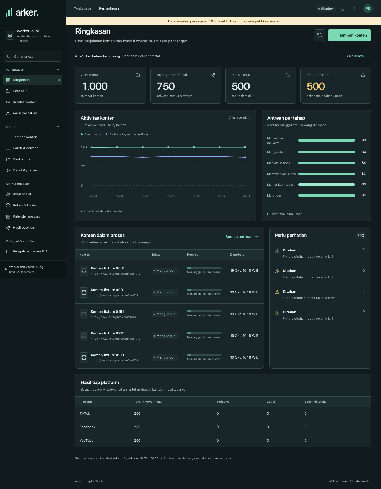
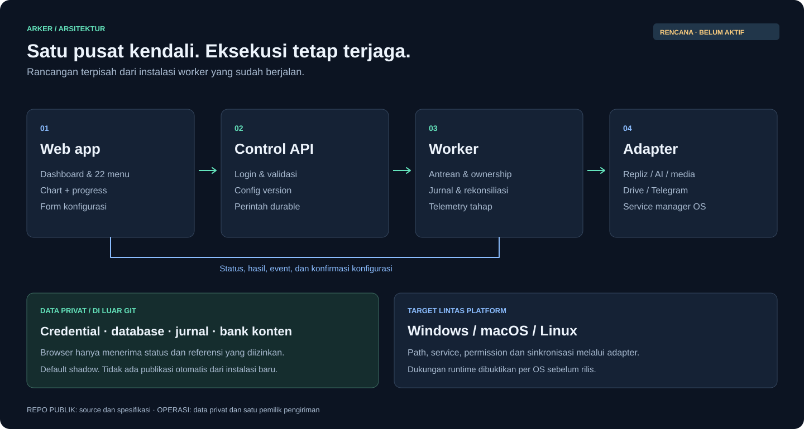
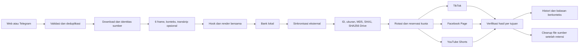
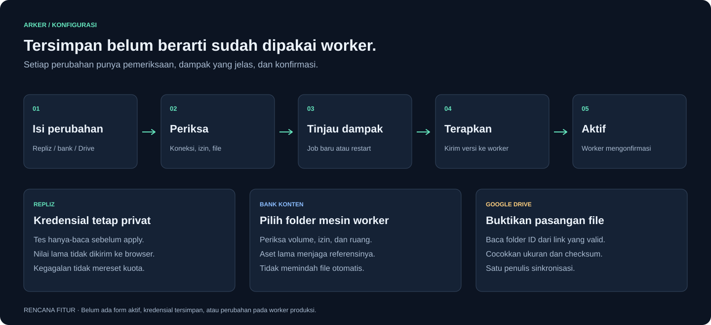

# Arker · Repliz Worker

Panel web untuk melihat perjalanan konten, mengatur worker, dan menyimpan konfigurasi dalam satu tempat. Web, API, dan worker tersedia untuk dijalankan dari repo ini.

**Mode awal shadow: tidak membuat jadwal publikasi atau membalas komentar.** Pengujian implementasi memakai data buatan dan transport provider terisolasi. Publikasi, balasan nyata, serta cutover dari instalasi lain belum dilakukan.

[Mulai menjalankan](docs/OPERATIONS.md) · [Menu lengkap](docs/plans/NAVIGATION.md) · [Bukti pengujian](docs/ACCEPTANCE.md) · [Kontrak provider](docs/architecture/PROVIDERS.md)



## Yang tersedia

- Login admin dengan sesi privat, password yang di-hash, pembatasan percobaan, dan perlindungan CSRF.
- 22 halaman untuk memantau antrean, akun, kuota, video, komentar, konfigurasi, penyimpanan, dan riwayat.
- Chart dari database, tabel data pendamping, tema terang/gelap, tampilan HP, dan pengaturan gerak minimal.
- Progress render dari waktu encoder FFmpeg. Tahap yang belum memiliki total menampilkan proses tanpa persen palsu.
- Form Repliz, AI, Google Drive, dan Telegram. Kredensial terenkripsi di backend dan tidak dikirim kembali ke browser.
- Konfigurasi berversi: tersimpan, menunggu diterapkan, dan aktif di worker. Koneksi yang gagal tidak mengganti konfigurasi aktif.
- Start, stop, dan restart worker melalui supervisor lokal. Panel tetap hidup ketika worker berhenti.
- Pipeline satu Reel menjadi satu aset dan tiga delivery: TikTok, Facebook Page, dan YouTube Shorts.
- Jurnal pengiriman, reservasi kuota, rekonsiliasi hasil ambigu, backup terverifikasi, dan cleanup dengan syarat retensi.

## Jalankan dari source

Prasyarat: Python 3.12+, Node.js 22.12+, FFmpeg dan ffprobe di PATH. Node hanya diperlukan untuk membangun frontend. Jalankan perintah berikut dari checkout baru; gunakan `python3` bila nama Python di OS Anda demikian.

```sh
python -m venv .venv
```

Aktifkan virtual environment:

| OS | Perintah |
| --- | --- |
| Windows PowerShell | `.venv\Scripts\Activate.ps1` |
| macOS / Linux | `source .venv/bin/activate` |

```sh
python -m pip install -r requirements.lock -e .
npm ci --prefix apps/web
npm run build --prefix apps/web
arker init
arker start
arker open
```

`arker init` meminta email dan password melalui terminal. Tidak ada akun atau password bawaan dalam source. Panel lokal menggunakan `http://127.0.0.1:8765`; bila port dipakai, jalankan `arker start --port 18765`. Data privat memakai direktori pengguna per OS, terpisah dari Git. Pilihan `--data-dir` diletakkan sebelum nama perintah.

Panduan [operasi](docs/OPERATIONS.md) menjelaskan instalasi wheel, konfigurasi bank/Drive, log, service saat login, backup, dan pemulihan. Pembungkus jendela desktop tersedia sebagai extra opsional; rilis ini tidak menyediakan installer native yang ditandatangani.

## Menu aplikasi

| Bagian | Menu |
| --- | --- |
| Pemantauan | Ringkasan; Peta alur; Kendali worker; Perlu perhatian |
| Konten | Tambah konten; Batch & antrean; Bank konten; Detail & preview |
| Akun & publikasi | Akun sosial; Rotasi & kuota; Kalender posting; Hasil publikasi |
| Video, AI & interaksi | Pengolahan video & AI; Persona & caption; Komentar & balasan; Laporan & statistik |
| Koneksi & penyimpanan | Koneksi layanan; Telegram & notifikasi; Penyimpanan & cleanup |
| Administrasi | Backup & pemulihan; Riwayat aktivitas; Pengaturan & akses |

## Alur kerja





Worker mempertahankan orientasi sumber, zoom 110%, tanpa mirror, hook sebelum detik 3, H.264/AAC, serta audio sumber. Caption publik selalu menyertakan `source: @username` berdasarkan metadata pemilik. Maksimal 20 video per akun per hari Asia/Jakarta; kuota balasan dihitung terpisah.

[Gaya hook dan caption](docs/HOOK_AND_CAPTION.md): teks singkat, Barlow yang lebih besar, susunan dua baris, dan caption santai yang mengikuti kejadian dalam video. Asal tulisan ditampilkan pada detail konten; AI yang belum aktif tidak diklaim sudah menyusun ulang caption.

Jadwal yang baru diterima tidak dihitung sebagai tayang. Hasil yang tidak pasti ditahan, lalu diperiksa melalui bukti provider. Mode shadow berhenti pada preview dan tidak membutuhkan akun provider untuk uji media lokal.

## Konfigurasi yang bisa diperiksa



Lokasi bank adalah folder pada mesin worker. Memasukkan link Drive tidak membuktikan file sudah tersinkron. Satu aplikasi eksternal menangani sinkronisasi; Arker memeriksa identitas, ukuran, dan semua checksum sebelum pengiriman. Google Drive Desktop tersedia di Windows/macOS, [tidak di Linux](https://support.google.com/drive/answer/2375082?hl=en). Linux memakai sinkronisasi eksternal yang disiapkan operator; Arker tidak menambah uploader kedua.

## Pengujian dan batas bukti

```sh
python -m pip install -r requirements-dev.lock -e .
python scripts/verify.py --media
python scripts/package.py
```

Verifier menjalankan pemeriksaan publikasi source, suite backend/worker/lifecycle, tes frontend, build, dan preview FFmpeg nyata dengan video buatan. Jaringan provider diblokir pada suite Python. CI menjalankan verifier yang sama di Windows, macOS, dan Linux. Lihat hasil pada tab [Actions](https://github.com/ramdanifahmy2023/arker-ap-repliz-worker/actions) dan [matriks penerimaan](docs/ACCEPTANCE.md).

Tes kontrak provider memakai fixture, bukan akun produksi. Model whisper.cpp untuk transkripsi, sinkronisasi Drive milik operator, autostart native, dan publikasi/reply nyata mempunyai batas bukti tersendiri. Mode live memerlukan scope akun eksklusif; aplikasi ini tidak mendeteksi atau mematikan pengirim di mesin lain.

## Struktur proyek

```text
apps/web/                 React, TypeScript, UI, dan tes frontend
src/arker/                API, autentikasi, DB, konfigurasi, worker, CLI
src/arker/adapters/       Repliz, Drive, AI, Telegram, downloader, FFmpeg
src/arker/assets/fonts/  Font Barlow dan lisensi OFL
config/examples/         Contoh konfigurasi tanpa nilai akses
docs/                    Operasi, penerimaan, arsitektur, rencana, worklog
spec/                    Spesifikasi navigasi dan makna metrik
scripts/                 Verifier, packaging, visual, pengujian browser
tests/                   Kontrak, kegagalan, recovery, dan lifecycle
.github/workflows/       CI tiga OS
```

Proyek ini tidak menyalin atau menautkan kode privat, runtime, database, credential, maupun bank instalasi lain. Baca [keamanan](SECURITY.md) dan [panduan kontribusi](CONTRIBUTING.md). Lisensi source belum ditetapkan; font yang dibundel memakai SIL Open Font License.
