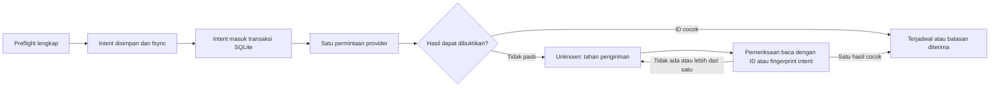

# Kontrak adapter dan batas bukti

Ditinjau 19 Oktober 2026. Dokumen ini menjelaskan kode adapter yang tersedia serta sumber kontraknya. Implementasi dan tes fixture bukan bukti bahwa sebuah akun produksi berhasil memublikasikan konten.

Pengujian proyek ini menggunakan transport HTTP buatan dan media sintetis lokal. Tidak ada jadwal, posting, balasan komentar, atau pesan Telegram nyata yang dikirim saat pengujian. Default instalasi adalah `shadow`, publikasi nonaktif, dan scope kepemilikan kosong.

## Batas antar komponen

Browser hanya memanggil Control API Arker. Backend menyimpan credential secara terenkripsi di data directory privat. Konfigurasi umum memuat nomor versi credential; nilainya tidak dikirim kembali ke browser atau dimasukkan backup umum. Worker membaca versi yang diterapkan. Penggantian credential menjalani tes baca sebelum worker mengakui versi baru.

Adapter tidak memakai database atau credential instalasi lain. Browser tidak menerima token platform. Pengaktifan konfigurasi baru tidak merender ulang konten lama; setiap aset menyimpan versi konfigurasi dan lokasi banknya.

## Repliz

Base URL tetap `https://api.repliz.com`. Adapter memakai Basic Auth dengan Access Key dan Secret Key. Metode baca dan tulis dipisahkan; permintaan tulis tidak mempunyai retry otomatis. Referensi autentikasi: [Public API Repliz](https://api.repliz.com/public).

| Operasi kode | Endpoint | Dampak dan bukti yang digunakan |
| --- | --- | --- |
| Daftar akun | `GET /public/account` | Membaca semua halaman; jumlah, identitas, dan penanda halaman harus lengkap. Pool lama bertahan jika snapshot gagal atau parsial. |
| Periksa identitas | `GET /public/account/{id}` | Memeriksa ulang ID, username, platform, dan koneksi sebelum pengiriman. Token tambahan yang mungkin ada pada respons tidak disalin ke state aplikasi. |
| Snapshot kuota dan rekonsiliasi | `GET /public/schedule` | Membaca jadwal pada rentang waktu. Jadwal remote dan reservasi lokal dihitung tanpa menggandakan reservasi yang sudah terlihat di provider. |
| Membuat jadwal | `POST /public/schedule` | Hanya setelah mode live, publikasi, ownership, sumber, kuota, dan Drive lolos. Respons dengan ID dan akun cocok berarti diterima/terjadwal. |
| Memeriksa hasil | `GET /public/schedule/{id}` | Status remote `pending`/`process`, `error`, dan `success` dipisahkan. Status sukses masih memerlukan tautan posting pada domain platform yang sesuai. |
| Membaca komentar | `GET /public/comment` | Hanya komentar yang cocok dengan akun dan posting terverifikasi lokal dipertimbangkan. Post dengan otomasi native tidak dikirimi reply kedua. |
| Mengirim balasan | `POST /public/comment/{id}` | Body berisi teks. Hasil harus menyertakan ID balasan; timeout atau hasil ambigu ditahan. |
| Membaca statistik | `GET /public/account/{id}/statistic` | Metrik numerik yang dikenali disimpan dengan waktu sampel. Data yang tidak tersedia tidak berubah menjadi angka nol. |

Sumber kontrak: [daftar akun](https://docs.repliz.com/api/account/get-account), [identitas akun](https://docs.repliz.com/api/account/get-one-account), [daftar jadwal](https://docs.repliz.com/api/schedule/get-schedule), [pembuatan jadwal](https://docs.repliz.com/api/schedule/create-schedule), [hasil jadwal](https://docs.repliz.com/api/schedule/get-one-schedule), [komentar](https://docs.repliz.com/api/comment/get-comment), [balasan](https://docs.repliz.com/api/comment/reply-comment), dan [statistik akun](https://docs.repliz.com/api/account/get-statistic-account).

Arker membatasi video maksimal 20 per akun/hari Asia/Jakarta. Batas lokal yang lebih rendah dan batas provider yang tersedia pada respons dihormati. Statistik pemakaian berasal dari snapshot jadwal lengkap. Kemampuan platform diturunkan dari kontrak publik yang dikenal; ini tidak menjamin entitlement paket atau izin setiap akun. Provider tetap dapat menolak permintaan. Akun baru harus berada dalam scope eksklusif yang ditetapkan admin sebelum ikut mengirim.

Adapter tidak menyediakan tombol untuk memaksa sukses, menghapus posting, atau mengulang pengiriman ambigu. Like komentar YouTube tidak diimplementasikan. Arker tidak mengubah otomasi native provider. Klaim `published` adalah hasil pemeriksaan bukti provider, bukan hasil inspeksi manual halaman sosial oleh manusia.

## Jurnal dan hasil yang belum pasti

Intent dan hasil disimpan sebagai file jurnal immutable di `journals/`, dengan lock bersama proses backup. Restart memulihkan intent yang sudah ada di file tetapi belum masuk SQLite. Hasil yang sudah tersimpan dapat dipakai untuk memulihkan ID remote. Jurnal bukan dukungan idempotency yang diklaim dari provider; deduplikasi dan keputusan menahan retry dilakukan Arker.

Setiap intent menyimpan versi konfigurasi asal, termasuk referensi versi credential. Rekonsiliasi memakai credential asal meskipun credential aktif sudah diganti. Metadata ini hanya berada di DB/jurnal dan tidak masuk body request provider. Intent lama tanpa versi asal ditahan untuk pemeriksaan; worker tidak menebak workspace provider.

## Google Drive dan bank konten

Adapter Drive hanya membaca metadata lewat Drive API v3. Credential saat ini berupa OAuth access token yang diisi admin. Token kedaluwarsa perlu diganti; alur login OAuth dan refresh token otomatis belum tersedia.

Bank lokal mempunyai satu penulis sinkronisasi eksternal. Pada Windows/macOS, pengguna dapat menyiapkan Drive Desktop. Pada Linux, pengguna harus menyiapkan sinkronisasi eksternal yang sesuai; Arker tidak memasang atau menjalankan pengunggah kedua.

Sebelum file dipakai untuk jadwal, adapter memastikan ada tepat satu file dengan nama dan parent folder yang sesuai, ID valid, ukuran sama, serta MD5, SHA-1, dan SHA-256 penuh yang cocok. Izin baca tautan untuk provider juga harus tersedia. Identitas dan SHA-256 diperiksa ulang tepat sebelum intent kirim. Kolom checksum yang hilang menyebabkan proses menunggu, bukan dianggap cocok. Referensi: [resource File Google Drive](https://developers.google.com/workspace/drive/api/reference/rest/v3/files).

Pemeriksaan ini tidak mengubah permission, memindah file, atau mengunggah media. Keterjangkauan unduhan oleh Repliz masih perlu dibuktikan melalui pilot yang diizinkan setelah tahap tanpa publikasi selesai.

## Downloader, media, dan transkrip

Input aplikasi dibatasi ke URL HTTPS Reel Instagram yang dikanonisasi. Downloader menjalankan [yt-dlp](https://github.com/yt-dlp/yt-dlp) memakai daftar argumen, mengabaikan konfigurasi global, dan menyimpan hasil di folder kerja aset. Metadata `uploader_id` dan identitas extractor menjadi sumber kredit; display name dan tebakan AI tidak dipakai.

[FFmpeg](https://ffmpeg.org/ffmpeg-filters.html) memeriksa media, mengambil enam frame, lalu membuat video bersama. Filter mengatur awal timestamp, mengambil sampel 30 fps sebelum overlay, mempertahankan orientasi, memakai zoom 110% tanpa mirror, dan menampilkan hook hanya untuk waktu kurang dari tiga detik. Output memakai H.264 dan AAC jika sumber memiliki audio. Metadata output disusun ulang. Progres render berasal dari `out_time_us` encoder dengan durasi hasil probe sebagai pembagi.

Hook menggunakan font Barlow Semi Condensed yang dibundel bersama lisensinya. Teks diukur dalam piksel sebelum gambar overlay dibuat. Bentuk font dan pengaturan ini berlaku pada render baru.

Transkripsi lokal opsional memakai [whisper.cpp](https://github.com/ggml-org/whisper.cpp). Audio sementara dikonversi menjadi WAV mono 16 kHz lalu diproses dengan executable dan model lokal yang dipilih admin. Model ASR tidak dibundel atau diunduh otomatis. Tes kontrak memeriksa argumen proses dan hasil fixture; akurasi transkripsi model nyata belum menjadi bukti pengujian ini.

## AI dan persona

Adapter menggunakan bentuk Chat Completions untuk [OpenAI](https://developers.openai.com/api/reference/resources/chat) atau [OpenRouter](https://openrouter.ai/docs/api_reference/overview). Model harus mendukung input gambar dan keluaran JSON yang digunakan. Koneksi baca memeriksa endpoint models; tes itu tidak membuktikan kemampuan vision atau kualitas hasil model.

Ketika AI aktif, konteks berisi caption sumber, enam frame, dan transkrip jika tersedia. Respons divalidasi sebagai fakta, hook, dan caption dengan batas panjang. Username kredit ditambahkan aplikasi setelah hasil AI diperiksa. Persona akun dapat memengaruhi caption per delivery serta reply, tanpa merender ulang video bersama. Binding menyimpan ID dan versi persona.

Ketika AI nonaktif, preview memakai caption sumber serta hook pertanyaan netral. Tidak ada klaim bahwa analisis visual AI atau transkripsi sudah terjadi. Reply kontekstual membutuhkan AI yang aktif, kuota terpisah, ownership, konteks posting, dan percakapan sebelumnya.

## Telegram

Adapter mengikuti [Telegram Bot API](https://core.telegram.org/bots/api): `getMe` untuk tes baca, `getUpdates` untuk input, dan `sendMessage` untuk pemberitahuan. Bot nonaktif pada default. Pengujian memakai transport atau provider fixture; tidak mengirim pesan nyata.

Input diproses hanya dari chat privat. Mode input publik berarti pengirim privat baru boleh memasukkan link; bukan membuka rincian batch kepada grup atau pengirim lain. Perintah jeda/lanjut hanya untuk ID admin yang dikonfigurasi. Offset update bertahan setelah restart. Pemberitahuan mempunyai intent tersendiri; hasil ambigu tidak dikirim ulang otomatis.

## Yang masih harus dibuktikan sebelum operasi nyata

- Credential dan entitlement provider pada akun khusus yang kepemilikannya sudah disepakati.
- Sinkronisasi bank pada OS sasaran, lengkap dengan ID, ukuran, dan seluruh checksum Drive.
- Download sumber yang diizinkan, kemampuan model AI, dan ASR nyata jika transkripsi dipakai.
- Pilot jadwal, bukti posting setiap platform, serta balasan pada scope komentar yang diizinkan.
- Akses jarak jauh, TLS, domain, dan pembungkus desktop native jika akan dipakai.

Tidak ada langkah pilot yang dijalankan oleh tes offline atau perintah preview lokal. Status hasil keseluruhan mengikuti worklog dan laporan verifikasi pada SHA yang diperiksa.
