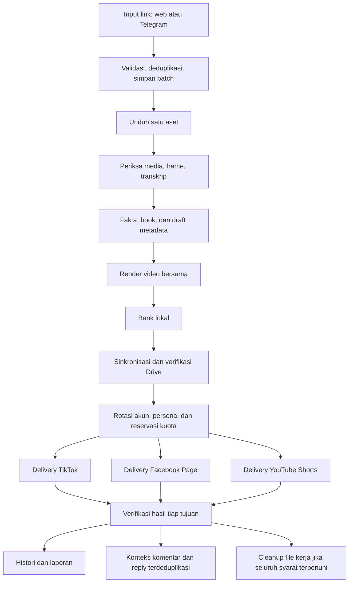

# Rencana produk Arker

Tanggal: 19 Oktober 2026. Arsip rancangan awal; implementasi tersedia. Status dan batas bukti terbaru ada di [penerimaan](../ACCEPTANCE.md).

## Permintaan yang sudah ditetapkan

- Proyek dan repo terpisah dari instalasi worker yang sudah berjalan.
- Repo publik bernama `arker-ap-repliz-worker`, dokumentasi rinci dan visual yang membantu memahami alur.
- Menu lengkap untuk operasi, konten, akun, AI, interaksi, penyimpanan, dan administrasi.
- Tampilan modern dengan chart dan progress bar beranimasi untuk menganalisis worker.
- Form konfigurasi kredensial Repliz, folder bank konten, dan link folder Google Drive.
- Target Windows, macOS, dan Linux. Ketersediaan suatu fitur harus dibuktikan per OS.

## Keputusan implementasi dan pekerjaan berikutnya

- Web app sebagai antarmuka pertama; pembungkus desktop setelah kebutuhan native jelas.
- Backend FastAPI/Python dan frontend React/TypeScript dengan versi dipin pada manifest/lockfile.
- Akses jarak jauh melalui jalur privat atau tunnel dengan autentikasi. Penyedia, domain, dan metode login belum dipasang.
- Akun admin tunggal pada rilis awal. Identitas dan password admin diisi saat pemasangan privat, tidak dimasukkan repo publik.
- Desain dark/light mengikuti sistem dengan pilihan pengguna; palet dan tipografi final ditinjau melalui preview.

## Alur konten

Satu aset tidak dihitung sebagai tiga video masuk. Tiga delivery memiliki status, akun, kuota, dan bukti hasil sendiri. Tujuan yang sudah berhasil tidak diulang ketika tujuan lain gagal.

## Batas perilaku yang dipertahankan

- Instagram adalah sumber. Tujuan paket baru: satu TikTok, satu Facebook Page, satu YouTube Shorts.
- Maksimal 20 video per akun per hari Asia/Jakarta; batas provider yang lebih rendah tetap berlaku. Kuota reply terpisah.
- Snapshot akun lengkap diperlukan untuk aktivasi rotasi. Reconnect memakai identitas dan histori lama. Daftar pengecualian akun diisi privat saat pemasangan.
- Satu akun/post hanya mempunyai satu pemilik pengiriman/reply. Token baru bukan pengganti pengaturan ownership.
- Profil media awal mempertahankan orientasi, tanpa mirror, zoom 110%, hook Indonesia sebelum detik 3, audio asli, H.264/AAC. Kredit sumber berasal dari pemilik terverifikasi.
- Persona dibatasi fakta video. YouTube tidak diberi tombol like komentar jika provider tidak mendukungnya.
- Cleanup minimal 24 jam sesudah tujuan wajib terakhir terverifikasi published. Bank, Drive, konteks dan histori tidak ikut dihapus.
- Hasil kirim yang ambigu ditahan untuk rekonsiliasi; tidak ada tombol pemaksa sukses.
- Histori lama, jika kelak dimigrasi secara eksplisit, mempertahankan tujuan asli dan semua bukti deduplikasi.

## Informasi yang harus mudah ditemukan

1. Worker tersambung atau tidak, berdasarkan heartbeat dan waktu data.
2. Tahap aktif, tahap tertahan, penyebab, dan tindakan berikutnya.
3. Versi konfigurasi yang diminta dibanding versi yang dipakai worker.
4. Status akun: terhubung, siap posting, siap reply, kuota, atau ditahan.
5. Hasil terverifikasi dibanding request yang baru diterima provider.

## Pemisahan dari instalasi lama

Repo ini memulai fondasi baru. Tidak menautkan runtime, memakai token, menyalin database, mengubah service, atau membaca folder bank instalasi lama. Integrasi ke instalasi lama memerlukan konektor terautentikasi yang dirancang tersendiri atau migrasi ownership dengan bukti; keduanya belum dibuat.

## Batas pemetaan

Tautan peta eksternal yang dirujuk dalam diskusi belum berhasil dibaca karena respons akses 403. Rencana ini diturunkan dari diskusi dan pola operasi yang telah dijelaskan, bukan klaim reproduksi lengkap peta tersebut. Isi privat peta dan identitas akun produksi tidak dipublikasikan.
